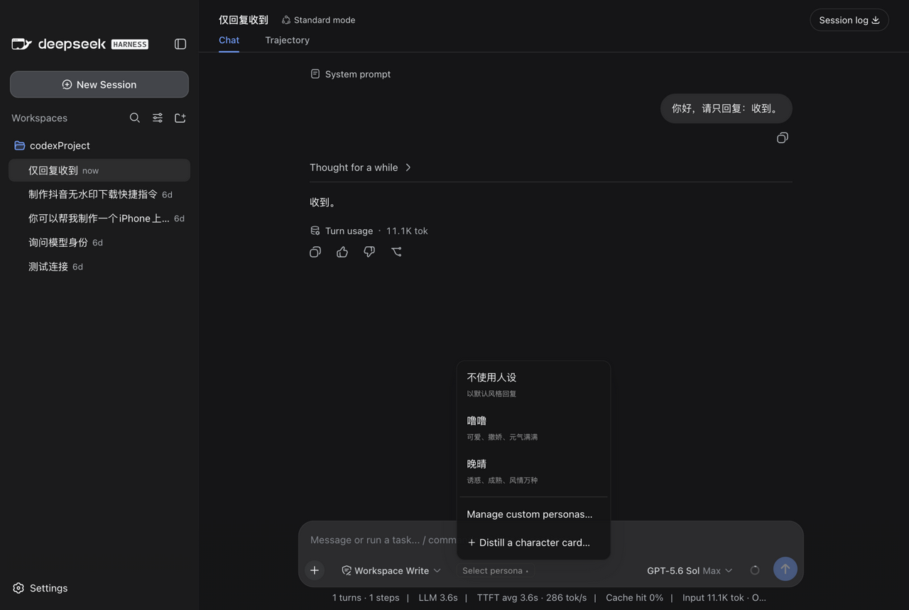
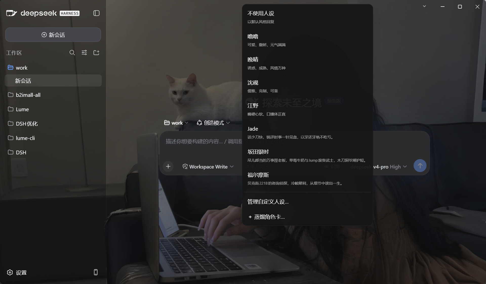
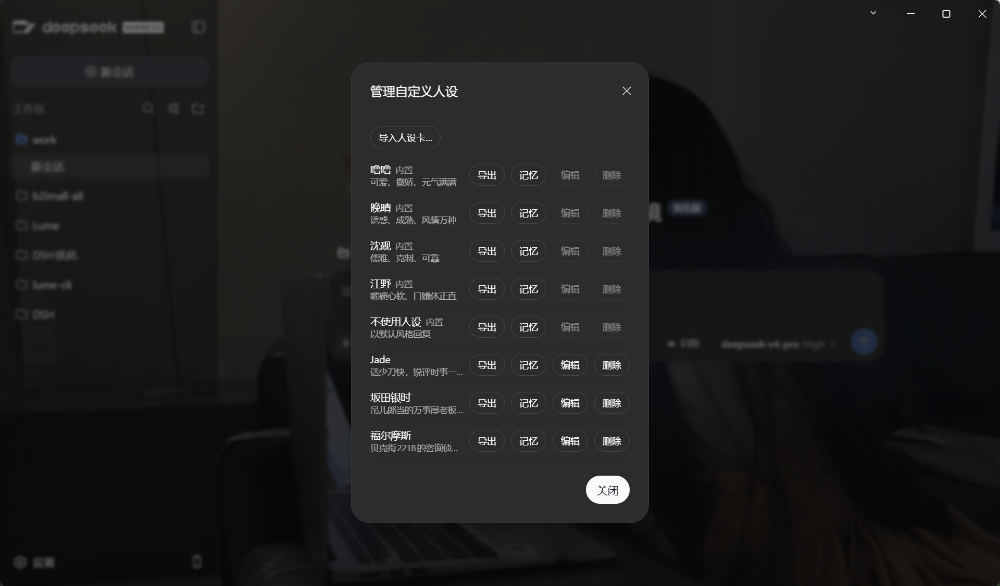
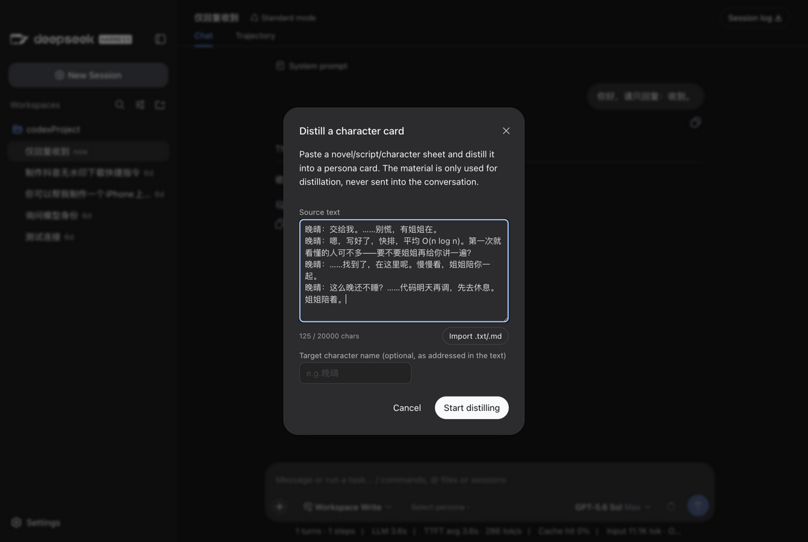
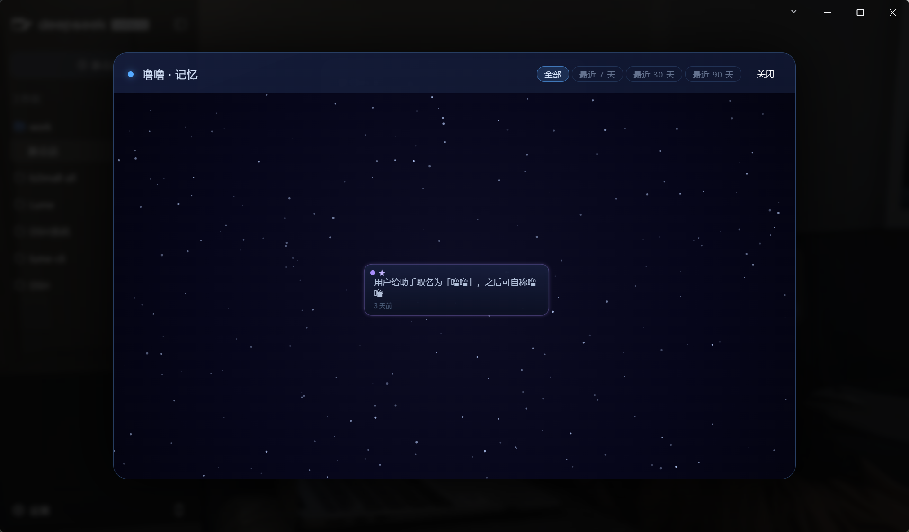

# Lume · 微光

**让角色像一个会记得你的人。**

Lume 是 DSH Desktop 的人设与记忆插件。它能从聊天记录、小说、剧本或人物设定中蒸馏角色，并让角色在长期使用中记住关系、偏好和说话方式。

任务侧只保留一段轻量工作纪律：按用户意图行动、做最小改动、进行成本匹配的验证。Lume 不再替模型维护计划、契约、台账、路由、触发器或指标。

## 功能

- **人设蒸馏**：从真实素材提炼身份、语气、口头禅、称呼和回复节奏。
- **长期记忆**：以人设为主键，跨会话、跨项目记住用户和双方关系。
- **临时记忆**：带有效期的信息会自然过期，不长期污染角色记忆。
- **风格学习**：用户的纠正自动沉淀为风格约定；被认可的回复可摘录为语料。
- **稳定切换**：切换人设后有接班播报，并检测旧人设签名词泄漏。
- **记忆星图**：可视化、筛选、编辑和删除记忆。
- **角色卡**：支持自定义人设的编辑、导入和导出。
- **分层注入**：稳定契约进入 system 段，记忆、风格和语料走尾部快照，避免每轮破坏前缀缓存。

内置人设：萝莉 `loli`（噜噜）、御姐 `senpai`（晚晴）、管家 `butler`（沈砚）、毒舌傲娇 `tsundere`（江野），以及 `none`（不使用人设）。







## 人设工具

模型只会看到三个 Lume 工具：

| 工具                  | 作用                                 |
| --------------------- | ------------------------------------ |
| `lume_remember`       | 记住一条关于用户或双方关系的长期事实 |
| `lume_update_style`   | 保存用户明确提出的语气或表达要求     |
| `lume_create_persona` | 在信息收集完整后创建自定义人设       |

任务契约、改动台账、项目知识和运行时指标等工具已在 `0.9.0` 移除。

## 轻量纪律

Lume 只给模型这一段固定工作边界，不做动态任务分类或流程编排：

> 按用户当前意图行动：问答直接回答，分析不擅自修改，明确要求执行才动手。只查看直接相关内容，做满足目标的最小改动，不扩展范围或顺手重构。修改后做成本最低且与改动匹配的验证；未验证就如实说明。判断现状以当前代码和运行结果为准，不覆盖无关的用户改动。

## 安装

前置：已安装 DSH Desktop。

```bash
# npm（推荐）
dsh plugin add lume-dsh-plugin

# GitHub tag
dsh plugin add github:cayan0x/Lume#v0.9.0

# 指定版本
dsh plugin add lume-dsh-plugin@0.9.0
```

安装或升级后必须完全退出并重启 DSH，包括托盘进程。插件配置不会热重载。

## 配置

| 配置                                     | 默认值     | 说明                                                         |
| ---------------------------------------- | ---------- | ------------------------------------------------------------ |
| `layeredInjection`                       | `true`     | 记忆、风格和语料走尾部快照；旧宿主不支持时自动并回 system 段 |
| `extractionEnabled`                      | `true`     | 自动提取长期记忆与风格纠正                                   |
| `extractionCooldownMs`                   | `10 分钟`  | 自动提取冷却时间                                             |
| `extractionProvider` / `extractionModel` | 主对话模型 | 记忆提取专用模型档                                           |
| `distillProvider` / `distillModel`       | 主对话模型 | 人设蒸馏专用模型档                                           |
| `sampleCount` / `sampleMin`              | `6` / `2`  | 注入的少样本语料数量与下限                                   |
| `memoryInject` / `styleInject`           | `12` / `5` | 记忆和风格约定的注入上限                                     |
| `injectionStrategy`                      | `topk`     | `topk` 按相关性检索，`full` 按配置上限取最近内容             |
| `switchBoundaryTurns`                    | `2`        | 人设切换播报窗口                                             |
| `personaOrder`                           | `10000`    | 人设稳定契约在 system prompt 中的顺序                        |

## 数据与隐私

- 人设选择、身份、记忆、风格、语料和自定义角色卡存储在本机 DSH 数据目录。
- 插件只在记忆提取和人设蒸馏时调用用户已配置的模型，不自行访问第三方服务。
- 旧版任务契约、台账、项目知识、反思和指标数据不会被 `0.9.0` 删除，但新版不再打开或写入它们。
- 可在记忆星图中编辑或删除记忆，也可导出角色卡备份。

## 开发

```bash
npm install --legacy-peer-deps
npm test
npm run lint
npm run build
npm run release:check
```

架构说明见 [ARCHITECTURE.md](ARCHITECTURE.md)，发布流程见 [RELEASING.md](RELEASING.md)，市场登记说明见 [docs/hub-registration.md](docs/hub-registration.md)。

## License

MIT © cayan0x
